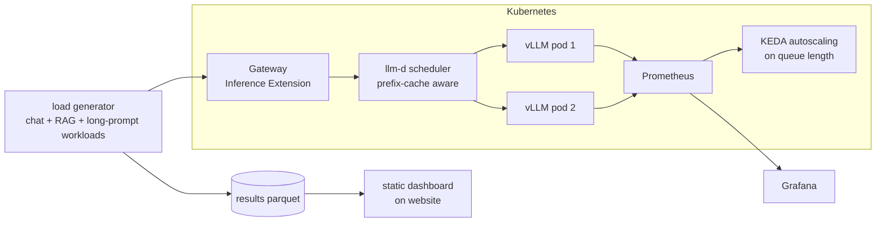

# Roadmap

> How fast and how cheap can an open LLM be served? A reproducible benchmark of quantisation,
> speculative decoding, caching and Kubernetes routing with llm-d, with cost per million tokens
> for every configuration.

Status: **planned** · no milestone started. A milestone is finished when its heading ends in "(done)".

## What it does

- Serves one open model (8B class) with vLLM in many configurations and measures each one under
  the same realistic load.
- Moves the best configurations onto Kubernetes with **llm-d**, and measures what intelligent
  routing adds over plain round-robin load balancing.
- Publishes an interactive results dashboard: latency, throughput, GPU memory and cost per
  million tokens for every configuration.
- Ends with a recommendation table: "for this traffic pattern, use this setup".

## What it proves

- Inference engineering: the part of LLM work that decides cost in production.
- Kubernetes for GPU workloads: scheduling, autoscaling on the right signal, observability.
- Benchmarking discipline: fixed workloads, warm-up, repeated runs, honest error bars.

Distinct from the other repos: no training and no application logic. Pure serving.
car-agent-harness only does a basic vLLM deployment; this repo owns the depth.

## Architecture



## Stack and why

| Need | Choice | Why |
|---|---|---|
| Engine | **vLLM** | most widely used open serving engine; OpenAI-compatible API |
| K8s serving layer | **llm-d** | CNCF sandbox project (since March 2026) built on vLLM: prefix-cache-aware routing, prefill/decode disaggregation, KV-cache offloading |
| Routing standard | Kubernetes **Gateway API Inference Extension** | what llm-d builds on; the emerging standard |
| Quantisation | FP8, AWQ/GPTQ int4 | the main memory/speed levers |
| Speculative decoding | draft model and n-gram / EAGLE-style methods supported by vLLM | lower latency at low load |
| Load testing | vLLM benchmark tooling / GuideLLM, plus own workload files | realistic prompt and output length mixes |
| Metrics | Prometheus + Grafana (vLLM exports metrics natively) | standard on Kubernetes |
| Autoscaling | **KEDA** on waiting-requests metric | GPU utilisation is a bad scaling signal for LLMs |
| Local dev | kind with a small model or a simulator, CPU | manifests tested without GPUs |

## Experiments

| # | Question | Variables |
|---|---|---|
| E1 | What does quantisation cost in quality, and what does it buy? | BF16 vs FP8 vs AWQ int4; quality on a small eval set |
| E2 | When does speculative decoding help? | off vs draft model vs n-gram; low vs high concurrency |
| E3 | How much does prefix caching save for RAG-style prompts? | caching on/off; shared-prefix workload |
| E4 | Batch and memory settings | max batched tokens, chunked prefill, GPU memory utilisation |
| E5 | Does llm-d routing beat round-robin? | 2 replicas, shared-prefix workload, compare TTFT and throughput |
| E6 | Autoscaling | queue-based scaling vs fixed replicas under a traffic spike |
| E7 | Prefill/decode disaggregation (if hardware allows) | long-prompt workload |

## Evaluation

| Metric | Meaning |
|---|---|
| TTFT p50/p95 | time to first token, what users feel |
| ITL p50/p95 | time between tokens while streaming |
| Throughput (tokens/s) at a latency target | capacity, not just raw speed |
| GPU memory, KV-cache usage | headroom |
| Cost per 1M output tokens | GPU price per hour / measured throughput |
| Quality delta | accuracy on a fixed eval set vs BF16, for E1 and E2 |

Every run: warm-up, 3 repetitions, workload files committed, hardware and versions recorded.

## Milestones

### M0 - Skeleton
uv, CLAUDE.md harness, CI, workload definitions, result schema, dashboard generator working on
fake results.

### M1 - Single-GPU benchmarks
E1-E4 on one rented GPU (Modal or a cloud VM), results to parquet and MLflow, first dashboard.
**Shows:** inference engineering basics, done properly

### M2 - Kubernetes manifests
Helm chart for vLLM + Prometheus + Grafana + KEDA, tested on kind (CPU, small model or
simulator) in CI.
**Shows:** GPU-ready Kubernetes packaging without paying for GPUs while developing

### M3 - llm-d on real GPUs
A short, planned session on a 2-GPU Kubernetes cluster (rented by the hour): E5-E7,
dashboards captured, cluster deleted afterwards.
**Shows:** distributed inference with current tooling

### M4 - Recommendations and write-up
Decision table per traffic pattern, cost model, blog-style write-up on the website.
**Shows:** turning measurements into decisions

### M5 - Live endpoint
Best single-GPU configuration as a scale-to-zero endpoint on Modal; the website page lets a
visitor send a prompt and see TTFT and tokens/s live.

## Demo and hosting

| Level | What | Cost |
|---|---|---|
| Always works | interactive static dashboard on the website (charts from committed results), Grafana screenshots, video of the llm-d session | $0 |
| Live | Modal endpoint with the best configuration, scales to zero, live latency readout | within Modal free credits for demo use |
| Production path | the Helm chart; anyone with a GPU cluster can reproduce | $0 to keep |

No GPU cluster is kept running. The expensive part (M3) is one planned session.

## Compute budget (estimate)

- M1: about 5-10 GPU hours on one L4/A10/A100-class GPU.
- M3: a few hours on a 2-GPU Kubernetes setup.
- Rough one-off total: $30-80, depending on GPU type. Plan the M3 session with a script so no
  time is wasted while the meter runs.

## CI/CD

- PR: lint, mypy, unit tests for metrics and cost calculations, Helm lint, kind install +
  smoke test with a tiny model or simulator.
- Manual GPU workflow: run an experiment, upload results, regenerate the dashboard.
- Main: rebuild the dashboard and publish it.

## Repo layout

```
workloads/{chat,rag_shared_prefix,long_prompt}.jsonl
src/bench/{run,collect,cost,report}.py
deploy/helm/{vllm,llm-d,observability}/
dashboards/grafana/*.json
site/ (static dashboard generator)
CLAUDE.md  Makefile  docs/adr/
```

## Risks

- GPU availability and price changes. Mitigation: scripts are provider-neutral; record the
  provider and price with each result.
- llm-d is young and moves fast. Mitigation: pin versions; note them in every result.
- Benchmarks that flatter one setup. Mitigation: publish workload files and raw results.

## Interview talking points

- Why TTFT and throughput at a latency target matter more than raw tokens/s.
- When speculative decoding helped and when it hurt.
- What prefix-aware routing changed for RAG traffic, with numbers.
